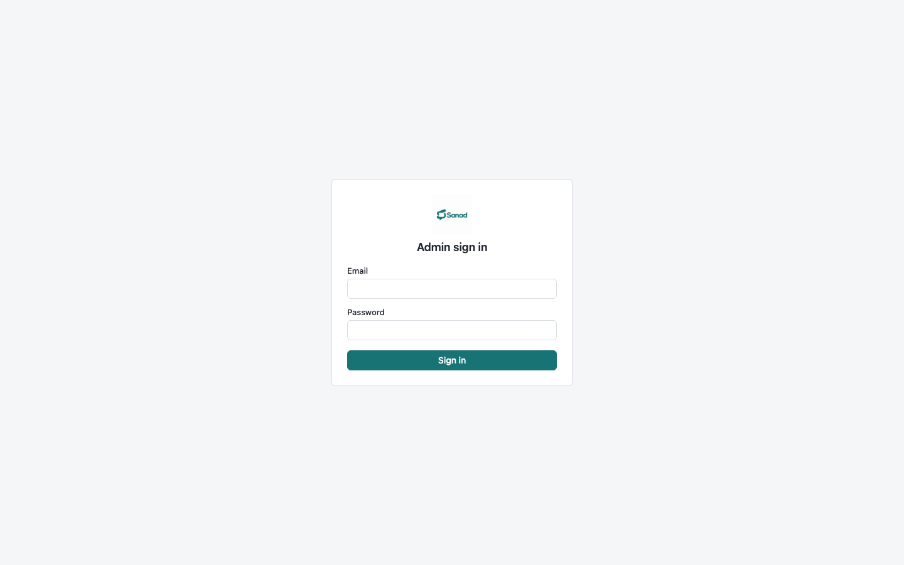
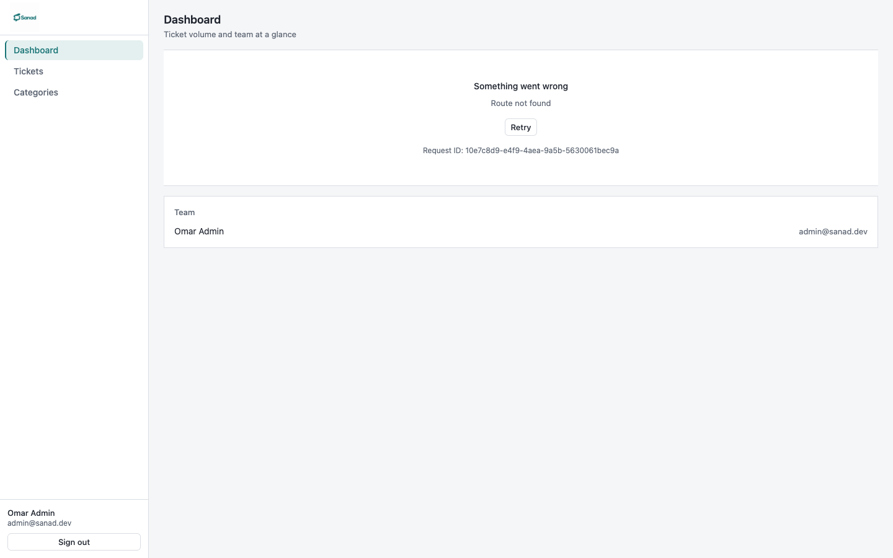
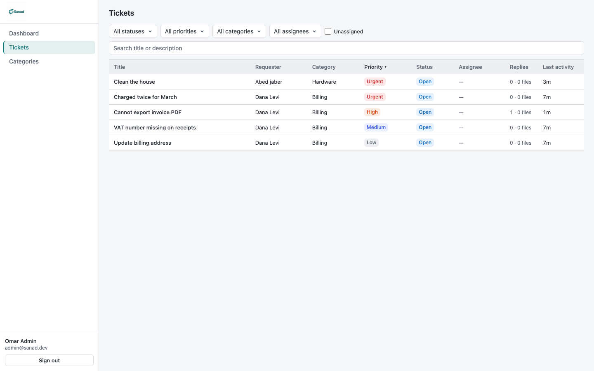
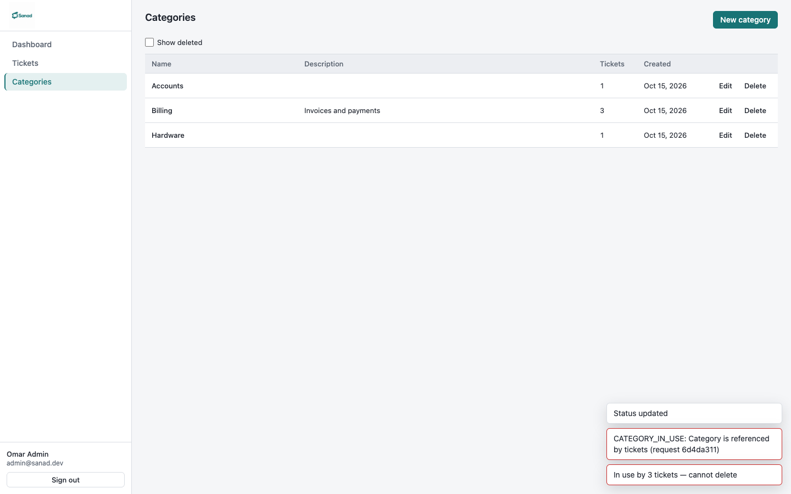

# Sanad Admin

Admin web dashboard for **Sanad**, a support ticket / helpdesk system. Staff sign in here to
triage tickets, manage categories and watch workload stats. Built with Vite, React 19,
TypeScript (strict), TanStack Query, react-hook-form + zod, Tailwind CSS 4 and Radix primitives.

The API contract lives in [`docs/API.md`](docs/API.md) (a verbatim copy owned by `sanad-server`).
Design tokens and principles: [`docs/DESIGN.md`](docs/DESIGN.md). Library and pattern rationale:
[`docs/DECISIONS.md`](docs/DECISIONS.md).

## Prerequisites

- Node.js ≥ 22
- A running `sanad-server` (sibling repo) — see its README; in short:
  ```sh
  cd ../sanad-server
  docker compose up -d   # MongoDB 7
  npm install && npm run dev   # API on http://localhost:4000
  ```

## Environment

```sh
cp .env.example .env
```

| Variable | Default | Purpose |
|---|---|---|
| `VITE_API_URL` | `http://localhost:4000` | Target of the dev proxy. The browser itself always calls `/api` on its own origin, so the server's httpOnly refresh cookie works without CORS. |

## Run

```sh
npm install
npm run dev        # http://localhost:5173
```

Other scripts: `npm run lint` · `npm run typecheck` · `npm run build` · `npm run preview`.

## Signing in

Only accounts with `role: "admin"` can sign in on the web client.

- **After server Phase 2:** run `npm run seed` in `sanad-server` and use the demo admin it prints
  (email only; the password comes from the server's `.env`).
- **Before the seed exists:** register a user via `POST /auth/register` and flip its `role` to
  `"admin"` directly in Mongo.

Session model: 15-minute access token in memory, silent restore on reload via the httpOnly
refresh cookie, automatic single-flight refresh on 401, redirect to sign-in with a notice when
the session truly expires.

## Deploying to Vercel

`vercel.json` carries two rewrites, in order: `/api/:path*` is proxied to the API server, and
everything else falls back to `/index.html` (SPA routing). The browser therefore only ever calls
its own origin — exactly the shape the Vite dev proxy gives locally — so the httpOnly
`SameSite=Strict` refresh cookie works in production unchanged, with no CORS and no cookie
relaxation. `VITE_API_URL` is not used on Vercel (it only feeds the dev proxy); the rewrite
points at the deployed API (`sanad-server-production-8573.up.railway.app`).

## Current scope (Phase 3b)

Everything is built against API contract **1.1.0** (`docs/API.md`):

- **Fully live today:** sign-in and session handling, app shell, category management
  (create / edit / soft delete / show-deleted, with 409 handling), the dashboard Team panel.
- **Built and waiting for the server:** dashboard stats, the ticket list (filters, search, sort,
  pagination — all URL-synced) and the ticket detail (status machine controls, assignee/priority/
  category, conversation with internal notes, authenticated attachment downloads, history
  timeline). Until the server's ticket/stats endpoints land these screens render their real error
  state — loading, empty and error states are genuine, no mock data.

## Screenshots

Current state, in [`docs/screenshots/`](docs/screenshots) — refreshed against the seeded server
once the server's seed script lands:

| | |
|---|---|
|  |  |
|  |  |
